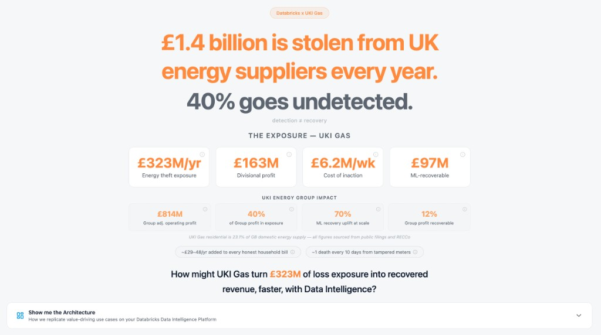
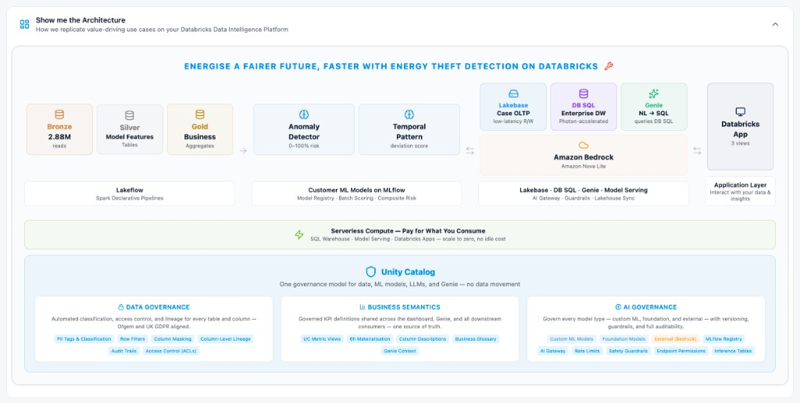

# UKI Gas Energy Theft Detection

AI-driven anomaly detection for UK energy retailers - built on Databricks APX (FastAPI + React).

Energy theft costs Great Britain an estimated GBP 830m-1.4bn per year, adding GBP 29-48 to every honest household's bill. UK suppliers detect only ~40% of expected cases against regulatory targets. This demo shows how Databricks unifies ML scoring, investigator workflows, Genie natural-language queries, and AI governance in a single deployable application - helping revenue protection teams recover stolen value faster and with full auditability.





**[Watch the full demo video](https://www.databricks.com/resources/demos/videos/detect-energy-theft-faster-genie)** - See the application in action with Genie natural-language queries, ML scoring, and investigator workflows.

See `docs/PRD.md` for the full product requirements document.

## Team Information

| Role | Name | GitHub |
|------|------|--------|
| Owner | Daniel Zoccali | @daniel-zoccali_data |

## Repository Structure

```
.
|-- src/energy_theft_detection/
|   |-- backend/          # FastAPI backend
|   |-- ui/               # React frontend
|-- notebooks/            # Databricks notebooks (medallion, ML, Genie)
|-- pipelines/            # Declarative SQL pipelines
|-- scripts/              # Deployment and utility scripts
|-- tests/                # pytest suite
|-- docs/                 # Documentation
|-- databricks.yml        # Databricks Asset Bundle config
```

## Prerequisites

- [uv](https://docs.astral.sh/uv/) (Python package manager)
- [bun](https://bun.sh/) (JavaScript runtime, used by APX for frontend)
- Python 3.11+
- Node.js 18+ (bun handles this)

## Local Development

```bash
# 1. Install Python dependencies
uv sync

# 2. Install frontend dependencies
bun install

# 3. Start the dev server (backend + frontend with hot reload)
bun run dev          # or: uv run apx dev start
```

The app starts at **http://localhost:9003**. Without a `SQL_WAREHOUSE_ID` configured, all endpoints return default values — this is the **offline mode** local experience, no Databricks connectivity required.

### Convenience Scripts

| Command | What it does |
|---------|-------------|
| `bun run dev` | Start dev server (FastAPI + Vite HMR) on port 9003 |
| `bun run test` | Run the full pytest suite |
| `bun run check` | TypeScript + Python type checking |
| `bun run build` | Production build into `.build/` |

### Environment Variables

The app uses a two-layer env config:

1. **`.env`** — safe defaults, committed to git. Works out of the box in offline mode.
2. **`.env.local`** — your workspace-specific overrides, **gitignored**. Values here take precedence.

To connect to a real Databricks workspace:

```bash
cp .env.local.example .env.local
# Edit .env.local with your workspace credentials
```

| Variable | Required | Description |
|----------|----------|-------------|
| `DATABRICKS_CONFIG_PROFILE` | No | Databricks CLI profile name (default: `DEFAULT`) |
| `SQL_WAREHOUSE_ID` | No | SQL Warehouse ID for live data |
| `AI_GATEWAY_ENDPOINT` | No | AI Gateway endpoint name for Bedrock LLM |
| `GEMINI_GATEWAY_ENDPOINT` | No | AI Gateway endpoint for Gemini LLM |
| `MAS_ENDPOINT` | No | Agent Bricks Multi-Agent Supervisor endpoint |
| `GENIE_SPACE_ID` | No | Genie Space ID for executive NL queries |
| `CATALOG` | No | Unity Catalog catalog name |
| `SCHEMA_NAME` | No | UC schema (default: `energy_theft_protection`) |
| `LAKEBASE_ENABLED` | No | Enable the Lakebase operational-serving path (default: `false`) |
| `LAKEBASE_INSTANCE_NAME` | No | Lakebase instance name (default: `energy-theft-lakebase`) |
| `LAKEBASE_SCHEMA` | No | Postgres OLTP schema (default: `revenue_protection`) |

### Running Tests

```bash
bun run test         # or: uv run pytest tests/ -v
```

All unit tests pass with no external dependencies — they run against the FastAPI test client in offline mode. Live integration tests require `APP_URL` and `DATABRICKS_PROFILE` (see Remote Deployment below).

### Type Checking

```bash
bun run check        # or: uv run apx dev check
```

TypeScript compilation must succeed. Python type errors from `notebooks/` are expected (PySpark types only available on Databricks runtime).

## Remote Deployment (Databricks Apps)

### Prerequisites

1. Databricks CLI configured with a workspace profile (e.g. `<your-profile>`)
2. A SQL Warehouse created in the target workspace
3. Unity Catalog schema `<your_catalog>.energy_theft_protection` created (see `docs/databricks_workspace_setup.md`)

### Deploy

```bash
# Set your SQL warehouse ID and choose a bundle target
export SQL_WAREHOUSE_ID=<your-warehouse-id>

# Build and deploy the bundle (endpoints, job, pipeline, app shell)
BUN_CONFIG_NO_VERIFY=1 uv run apx build
uv run databricks bundle deploy -t <your-target> --var sql_warehouse_id=$SQL_WAREHOUSE_ID

# Deploy app source code (path is printed by bundle deploy)
databricks apps deploy energy-theft-detection \
  --profile <your-profile> \
  --source-code-path "/Workspace/Users/<your-user>/.bundle/energy-theft-detection/<your-target>/files/.build"
```

### Post-deploy validation

```bash
uv run python3 scripts/validate_deployment.py \
  --profile <your-profile> \
  --target <your-target> \
  --app-url https://<your-app>.databricksapps.com
```

### Smoke test checklist

After deployment, walk through these pages to confirm end-to-end health:

1. `GET /api/health` — SQL connected, catalog matches your deployment
2. `/dashboard` — KPI tiles load, Genie panel responds
3. `/investigation` — case list loads, LLM summary calls the OpenAI gateway
4. `/governance` — audit trail populated, external lineage shows 4 Power BI reports
5. `/board-report` — Agent Atlas trace (MAS or graceful fallback)
6. `/presentation` — overview slides for demo narration
7. `/why-databricks` — compete messaging renders (if enabled)

### Live integration tests

```bash
APP_URL=https://<your-app>.databricksapps.com \
DATABRICKS_PROFILE=<your-profile> \
uv run pytest tests/test_remote_integration.py -v
```

### Cross-workspace reconciliation

After redeploying, compare the new app against a saved baseline to verify Power BI lineage parity:

```bash
python3 scripts/reconcile_workspaces.py \
  --snapshot https://<your-app>.databricksapps.com \
  --out /tmp/before.json

python3 scripts/reconcile_workspaces.py \
  --compare /tmp/before.json \
  --after https://<your-app>.databricksapps.com
```

A clean reconciliation shows 0 differences and `source=live` for external lineage.

### Data Setup (on Databricks cluster)

1. Run `sql/01_create_tables.sql` to create the Unity Catalog tables
2. Run `notebooks/01_generate_synthetic_data.py` as a notebook on a cluster to populate 100K synthetic accounts
3. Provision the Lakebase operational-serving layer (instance + synced table + OLTP schema):

   ```bash
   uv run python3 scripts/provision_lakebase.py \
     --profile <your-profile> --catalog <your_catalog> --warehouse-id <your-warehouse-id>
   ```

   or run `notebooks/10_provision_lakebase.py` on a cluster. The script is
   idempotent and prints a committable run log (see `docs/evidence/`).

## Architecture

- **Backend:** FastAPI (Python) — reads analytics from Delta via SQL Warehouse; reads/writes operational state from Lakebase (Postgres)
- **Frontend:** React + TypeScript + Vite + shadcn/ui + TanStack Router/Query
- **Data (analytics):** Unity Catalog (`<your_catalog>.energy_theft_protection`), Delta tables + Metric Views
- **Data (operational serving):** Lakebase (managed Postgres) — a synced table of the risk queue from Delta, plus an OLTP case-management schema (`revenue_protection.investigation_cases` + `case_events` audit log)
- **ML:** Isolation Forest + LSTM ensemble (pre-computed scores in Delta, synced to Lakebase for serving)
- **NL:** Genie Conversation API (executive queries over Metric Views)
- **LLM:** FMAPI (openai-gateway → `databricks-claude-sonnet-4`) via AI Gateway (investigation case summaries); Bedrock gateway also deployed but not the default
- **Deploy:** Databricks Apps via DABs (Databricks Asset Bundles)

## Personas

- **Susie Chambers** (Head of Revenue Protection) — Executive Dashboard, Genie NL queries
- **Robbie Henderson** (Senior Analyst) — Investigation Workbench, LLM case summaries

## Pages

| Page | Persona | Description |
|------|---------|-------------|
| Executive Dashboard | Susie | KPI tiles, risk heatmap, trend chart, fuel split, Genie panel |
| Investigation Workbench | Robbie | Flagged accounts table, detail drawer, signal breakdown, LLM summary |
| AI Governance | Both | PII matrix, component registry, UC lineage DAG, AI Gateway audit |
| Why Databricks | Demo | Advisory compete page (5 sections + architecture summary) |
| Presentation | Demo | 9-slide overview for show-me-don't-tell-me delivery |

## Documentation

All documentation lives in `docs/`:

- `PRD.md` - Full product requirements
- `tech_stack.md` - Architecture decisions
- `demo_architecture.md` - End-to-end walkthrough
- `databricks_workspace_setup.md` - Workspace configuration guide
- `external-lineage.md` - Power BI external lineage setup

## Contributing

1. **Branch from `main`** - never commit directly to `main`
2. **Branch naming:** `feat/<work>` for features, `fix/<issue>` for fixes (lowercase)
3. **Run tests and lint before opening a PR:**
   ```bash
   bun run test
   bun run check
   ruff check . && ruff format .
   ```
4. **Squash-merge only** - write a meaningful PR title/description
5. **Code review required** - see `.github/CODEOWNERS`

See [`AGENTS.md`](AGENTS.md) for detailed coding conventions.

## Managing Secrets

**Never commit tokens, API keys, or credentials to this repository.**

- Use a gitignored `.env.local` for local development
- For deployed apps, use Databricks Secret Scopes
- See [`ACCESS_TOKEN_HANDLING.md`](ACCESS_TOKEN_HANDLING.md) for the full policy

This repository is monitored by Drawbridge for secret detection.

## Using AI Coding Assistants

This repo supports AI-assisted development with Cursor, Claude Code, and similar tools.

- **Read [`AGENTS.md`](AGENTS.md)** for repo-specific rules (also mirrored to `.cursorrules`)
- **Read [`AI_CODING_GOTCHAS.md`](AI_CODING_GOTCHAS.md)** for common pitfalls and best practices
- Always review AI-generated code before committing
- Run the test suite to catch logical errors

## License

See [`LICENSE`](LICENSE) for terms. This demo is provided for use with Databricks Services.

## Support

This is a demo application provided on a best-effort basis. See [`NOTICE.md`](NOTICE.md) for support policy.
