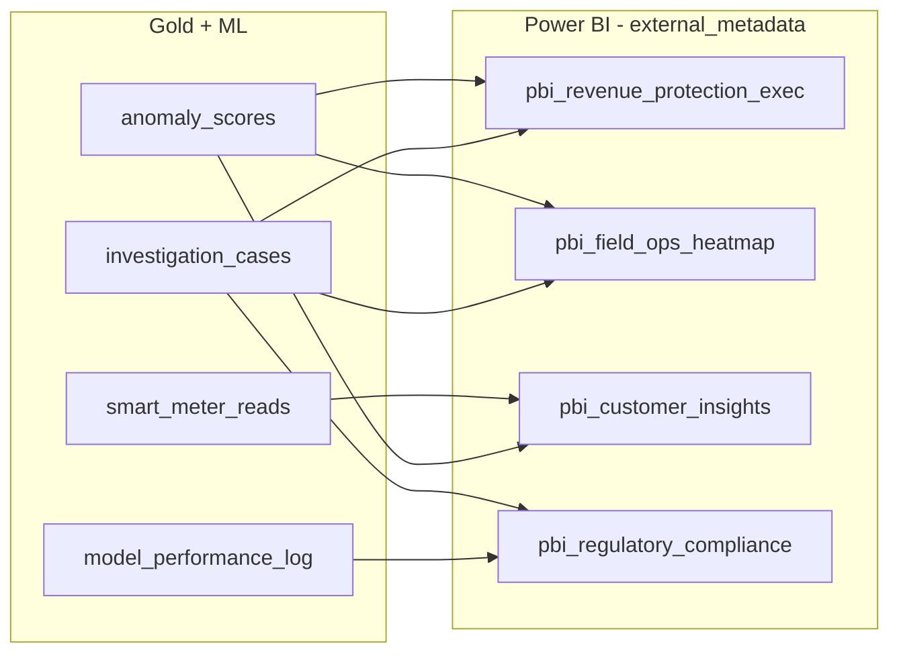

# External Lineage — Power BI ↔ Unity Catalog

Four fake Power BI reports show up as **first-class downstream consumers** of
the demo's gold tables in two places:

1. **Unity Catalog itself** — Catalog Explorer's lineage graph shows each
   Power BI report as a downstream object of `anomaly_scores`,
   `investigation_cases`, `smart_meter_reads`, and `model_performance_log`,
   with **column-level** edges. Powered by the GA
   [External Metadata + External Lineage APIs][ms-extlineage].
2. **The app's `UC Lineage` tab** — a 5th column ("External BI") appears
   when the **External Lineage** switch is flipped on in the
   `LineageDAG` `CardHeader`.

[ms-extlineage]: https://learn.microsoft.com/en-gb/azure/databricks/data-governance/unity-catalog/external-lineage

## Architecture



Same source of truth, three artifacts:

| Layer | File | Reads `external_lineage_objects.py` for |
|---|---|---|
| Unity Catalog | `notebooks/09_configure_external_lineage.py` | report names, columns, URLs, column-edge mappings |
| App backend | `src/.../backend/router.py` `/api/governance/external-lineage` | fallback data when live UC read fails |
| Power BI artifacts | `scripts/generate_pbip.py` | TMDL columns + DAX measures per report |

The shared module is at [`scripts/setup/external_lineage_objects.py`](../scripts/setup/external_lineage_objects.py).

## The four reports

| Name (UC `external_metadata`) | Display | Entity type | Upstream UC tables |
|---|---|---|---|
| `pbi_revenue_protection_exec` | Revenue Protection Executive Dashboard | `dashboard` | `anomaly_scores`, `investigation_cases` |
| `pbi_field_ops_heatmap` | Field Operations Heat Map | `report` | `anomaly_scores`, `investigation_cases` |
| `pbi_customer_insights` | Customer Insights & Theft Patterns | `report` | `smart_meter_reads`, `anomaly_scores` |
| `pbi_regulatory_compliance` | Regulatory Compliance Report (TDIS R0173) | `report` | `investigation_cases`, `model_performance_log` |

Every column edge is listed in `external_lineage_objects.COLUMN_EDGES`
(23 edges total at the time of writing) — the bootstrap notebook creates one
UPSTREAM relationship per edge using the SDK's
`WorkspaceClient.external_lineage.create_external_lineage_relationship(...)`.

## How the toggle behaves

- **OFF (default)**: the `LineageDAG` renders exactly as today — Source →
  ML Models → Scored Output → LLM/Outputs (4 columns).
- **ON**: a 5th column "External BI" appears with Power-BI-yellow
  (`#F2C811`) accents and a `LayoutDashboard` icon. The frontend fetches
  `GET /api/governance/external-lineage` (cached 10 min) and merges the
  returned `nodes`/`edges` into the existing arrays so the SVG renderer
  and node detail sheet work unchanged.
- A Power-BI-yellow **roadmap callout** appears above the DAG, framing
  today's path (GA External Metadata APIs) and tomorrow's path
  (Lakeflow Connect for Power BI, native PBI capture, Microsoft Fabric
  cross-lineage). The callout also surfaces the `source` field on the
  response (`live` vs `fallback`) so the audience can see which path
  served them.
- The detail sheet for an `external_bi` node shows the Power BI badge,
  the click-through URL (purely cosmetic — fake report GUIDs), and the
  per-column listing.

## Backend endpoint

`GET /api/governance/external-lineage` returns:

```json
{
  "nodes": [
    { "name": "pbi_revenue_protection_exec",
      "display": "Revenue Protection Executive Dashboard",
      "system_type": "POWER_BI",
      "entity_type": "dashboard",
      "url": "https://app.powerbi.com/groups/.../reports/.../ReportSection?...",
      "description": "...",
      "columns": ["account_id", "high_risk_score", "risk_band", ...]
    },
    ...
  ],
  "edges": [
    { "source_table": "anomaly_scores",
      "source_column": "composite_risk_score",
      "target_external": "pbi_revenue_protection_exec",
      "target_column": "high_risk_score" },
    ...
  ],
  "source": "live"  // or "fallback"
}
```

- **Live path**: reads via `WorkspaceClient.external_metadata.list_external_metadata()`
  filtered to objects whose `properties.created_by ==
  "energy-theft-end-to-end"`, then lists upstream lineage relationships
  per object via `WorkspaceClient.external_lineage.list_external_lineage_relationships(...)`.
- **Fallback path**: returns the static `POWER_BI_REPORTS` /
  `COLUMN_EDGES` from the shared module — used when (a) the metastore
  isn't bootstrapped yet, (b) the SP doesn't have privilege, or
  (c) any unhandled exception in the live path. Surfaces as
  `source: "fallback"` so the UI can call it out.

## Running it

```bash
# One-shot: register the four PBIs + 23 column edges in your UC metastore
databricks bundle run end_to_end \
    --target <your-target> \
    --profile <your-profile>

# Or just the bootstrap task once the bundle is deployed
databricks bundle run end_to_end \
    --target <your-target> \
    --profile <your-profile> \
    --only-tasks configure_external_lineage
```

Then verify either via Catalog Explorer (Lineage tab on any of the four
upstream tables) or via the app:

```bash
TOKEN=$(databricks --profile <your-profile> auth token | jq -r .access_token)
curl -sS -H "Authorization: Bearer $TOKEN" \
    "https://<your-app>.databricksapps.com/api/governance/external-lineage" \
    | jq '{ source, n_nodes: (.nodes | length), n_edges: (.edges | length) }'
```

### Privilege

The notebook needs `CREATE EXTERNAL METADATA` on the metastore. Grant
it as a metastore admin:

```sql
GRANT CREATE EXTERNAL METADATA ON METASTORE TO `<account-admin-or-sp>`;
```

If the privilege isn't held, `notebooks/09_configure_external_lineage.py`
**soft-skips** (exits 0) without modifying any existing UC objects. The
backend endpoint then returns `source: "fallback"` (or live UC reads when
still readable) and the UI keeps working.

By default the notebook **preserves** existing demo `external_metadata`
objects (`force_recreate=false`). Only when an admin explicitly sets
`force_recreate=true` and the CREATE probe passes will it DELETE→CREATE.

## The `.pbip` deliverables

Four standalone Power BI Project (`.pbip`) directories under
`dashboards/powerbi/`:

```
dashboards/powerbi/
├── revenue-protection-exec/
│   ├── revenue-protection-exec.pbip
│   ├── revenue-protection-exec.Report/
│   │   ├── definition.pbir
│   │   └── report.json
│   └── revenue-protection-exec.SemanticModel/
│       ├── definition.pbism
│       └── definition/
│           ├── database.tmdl
│           ├── model.tmdl
│           ├── expressions.tmdl       (M parameters)
│           ├── cultures/en-US.tmdl
│           └── tables/
│               ├── anomaly_scores.tmdl
│               └── investigation_cases.tmdl
├── field-ops-heatmap/
├── customer-insights/
└── regulatory-compliance/
```

Each `.pbip` opens directly in **Power BI Desktop** (2024+). On first
open you'll be prompted to fill the four M parameters:

| Parameter | Example |
|---|---|
| `workspace_host` | `https://adb-<workspace-id>.<cloud>.databricks.net` |
| `http_path` | `/sql/1.0/warehouses/<warehouse-id>` |
| `catalog_name` | `demo_catalog` |
| `schema_name` | `energy_theft_protection` |

Authentication uses the standard Databricks Power BI connector
(`Databricks.Catalogs`) and supports both Azure AD and PAT.

### Regenerating

The `.pbip` directories are deterministic outputs of the shared module —
re-run the generator any time:

```bash
python scripts/generate_pbip.py                          # all 4
python scripts/generate_pbip.py --only=pbi_customer_insights
python scripts/generate_pbip.py --catalog=my_cat --schema=my_sch
python scripts/generate_pbip.py --validate-only          # structural checks only
```

The generator deletes the per-report directory before re-emitting, so
re-runs produce a clean tree (no stale files from a previous structure).

### Visuals

Each `report.json` contains one page with N **Card** visuals — one per
illustrative DAX measure declared in `_REPORT_MEASURES` in
`scripts/generate_pbip.py` (e.g. `HighRiskAccounts`, `RecoveredGBP`,
`DetectionPrecisionPct`). The visuals are deliberately minimal so the
artifact opens cleanly; once it opens, you can extend with whatever
charts you want, save, and re-commit.

## Converting to AI/BI Dashboards (deferred)

Out of scope for this branch. Two reasonable paths:

1. **Databricks preview "Migrate Power BI to AI/BI"** — point it at the
   `.pbip` directory and let the converter produce a `.lvdash.json`.
   When that GA's the deferred work converges with our roadmap callout
   in the UI.
2. **Agent-driven transform** — script a `.pbip → .lvdash.json`
   transform that maps TMDL tables → AI/BI dataset blocks and the Card
   visuals → AI/BI counter widgets. The `.pbip` artifacts here are
   intentionally structured (one TMDL table per UC table, one Card per
   measure) to make this transform straightforward.

Either path inherits the shared module's truth — UC, the app, and the
AI/BI dashboards all stay in sync because they all read the same column
edges.
